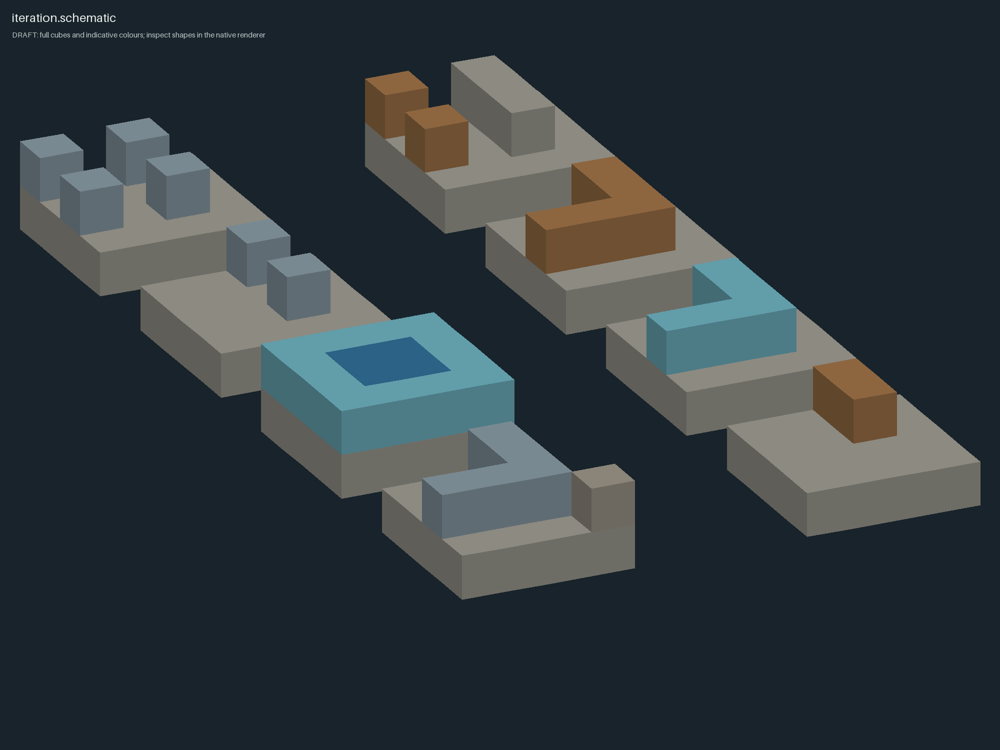
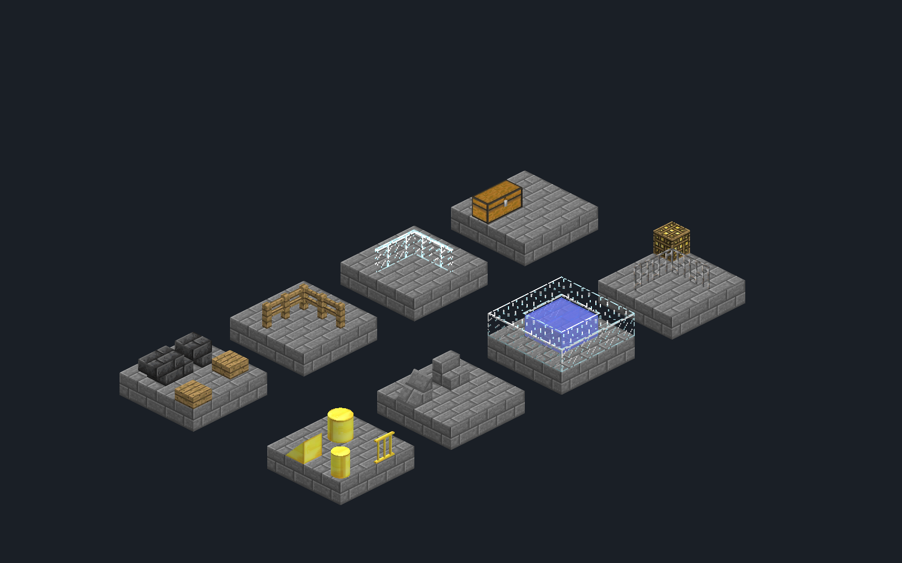

# GTNH Design

Инструменты для проектирования построек в GT New Horizons. Сначала можно оценить объём по быстрому наброску, затем посмотреть чертёж schematic с настоящими моделями игры и внести правки без перезапуска клиента.

| Режим | Что показывает | Что требуется |
| --- | --- | --- |
| `render_fast.py` | Объём, силуэт и примерные цвета. Все блоки показаны кубами | Python версии 3.10 или новее, NumPy, Pillow |
| `render_native.py` | Ступени, плиты, ограды, текстуры и модели блоков с TileEntity. Использует Minecraft, Schematica и установленные моды | macOS/APFS, Prism, установленная GTNH 2.9.0-RC-2 с lwjgl3ify/SDL, JDK 21, графическая сессия |

Нативный режим рисует сцену средствами игры в отдельном скрытом клиенте. Ему нужны OpenGL, графическая сессия и память для сборки. Он не захватывает мышь и после первого запуска остаётся готовым к следующим правкам.

| Быстрый набросок | Нативный рендер того же стенда |
| --- | --- |
|  |  |

На тестовом стенде есть ступени, плиты, ограды, стекло, вода, сундук и блоки Chisel, ArchitectureCraft и Carpenter's. [Результаты проверки](docs/verification.md).

## Быстрый старт

```sh
python3 -m venv .venv
source .venv/bin/activate
python -m pip install -r requirements.txt
python example_scene.py
python render_fast.py runtime/example.schematic --output runtime/example-draft.png
python schematic.py runtime/example.schematic
python -m unittest -v test_tools
```

`example_scene.py` создаёт тестовый стенд без данных пользовательского мира. Для быстрого рендера не нужны конфиг и запущенный Minecraft. Ракурс можно изменить через `--azimuth`, остальные параметры посмотреть через `--help`.

## Нативный рендер

1. Установите GTNH 2.9.0-RC-2 в Prism, войдите в аккаунт Minecraft и один раз успешно запустите сборку. Для тестового стенда нужны Schematica с её зависимостями, ArchitectureCraft, Carpenter's Blocks, Chisel и Et Futurum Requiem.
2. Подготовьте отдельный локальный мир для предпросмотра. В `preview_world` укажите имя его папки в `saves`, а не название из меню игры. Рендер будет работать с копией этого сохранения в отдельном экземпляре Prism.
3. Скопируйте `config.example.json` в `config.local.json`. Укажите пути к данным и исполняемому файлу Prism, JDK 21, исходному экземпляру и сохранению. Git игнорирует локальный конфиг. Если он лежит в другом месте, задайте путь через `GTNH_DESIGN_CONFIG`.
4. Выполните:

```sh
python build_native.py
python render_native.py runtime/example.schematic --id example-native
python worker.py status
```

Шесть PNG и отчёт `result.json` появятся в `runtime/renders/example-native/`. Для следующего рендера задайте новый `--id`: команда перечитает schematic, даже если путь к файлу не изменился. Повторно использовать существующий ID нельзя. Размер кадра задаётся, например, так: `--width 1920 --height 1200`.

Проверьте отчёт: `status=complete`, `gl_error=0`, пустой `renderer_messages`, ожидаемые размеры и число TileEntities. Затем посмотрите PNG, чтобы оценить сам дизайн.

Открытый Prism иногда не замечает папку только что созданного экземпляра. Если Java не запускается, закройте и снова откройте Prism, затем повторите команду. После обычных правок schematic перезапускать его не нужно.

```sh
python verify_native.py     # реальный стенд: ошибка импорта, recovery, две итерации, один PID
python worker.py stop       # штатное завершение скрытого клиента
```

`verify_native.py` сохраняет отчёт в локальный `runtime/verification.json`. Первый запуск может занять несколько минут.

Моды и ресурсы подключены из исходной установки, поэтому не меняйте их во время рендера. Конфиги и сохранение скопированы средствами APFS и отделены от оригиналов. Для предпросмотра выбирайте локальный тестовый мир: сохранения могут содержать личные данные. Небольшой мир запустится быстрее, а большой при первом старте может долго сканироваться VisualProspecting.

Фоновый клиент привязан к папкам клона репозитория и исходной установки. Если переместите инструменты или создадите второй клон, задайте другое `worker_instance`. Можно также штатно остановить и пересоздать прежний тестовый экземпляр.

Для диагностики есть режим `--interactive`: он подключает рендер к исходному видимому экземпляру Prism. По умолчанию используется отдельный скрытый клиент.

## Рельеф и формат

Чтобы посмотреть постройку на настоящем рельефе, возьмите нужный участок из локальной копии мира:

```sh
python world_crop.py --world /absolute/path/to/world-copy \
  --bounds 0 60 0 31 100 31 --dimension 0 \
  --output projects/terrain.schematic
```

Границы входят в участок, порядок координат: `X0 Y0 Z0 X1 Y1 Z1`. Скрипт открывает источник только для чтения и не разрешает сохранить результат внутри исходного мира. Если нужных чанков нет, он вернёт ошибку. Для Nether используйте `--dimension -1` и каталог `DIM-1`, для End - значение `1` и каталог `DIM1`.

В Python массивы блоков идут в порядке Y,Z,X. `schematic.write()` сохраняет палитру имён `SchematicaMapping`, метаданные блоков, TileEntity NBT с исходными типами тегов и `WEOrigin`. Высокие серверные ID находятся по именам блоков; в локальной палитре Alpha помещается 4096 значений. Числовые ID из другого мира подставлять нельзя. Для старого Alpha без имён скриптам `render_fast.py` и `schematic.py` нужен `--registry` с JSON вида `{"0":"minecraft:air","1":"minecraft:stone"}`.

Данные составных блоков сохраняются в `GTNHPreviewMultipart`, который читает этот рендер. Метаданные выше 255 остаются в `GTNHPreviewMetadata` для проверки, но при отрисовке используется только младший байт. Такие блоки рельефа могут отображаться неточно. Другие инструменты вставки могут не поддерживать эти расширения.

Рендер показывает schematic, но не строит его в мире. Для вставки нужен отдельный инструмент с поддержкой NBT, ориентации блоков и высоких GTNH ID. Schematica Printer не восстанавливает произвольный TileEntity NBT: блоки ArchitectureCraft могут стать одинаковыми колоннами. Обычный WorldEdit 6.1.1 ограничен 12-битными ID и не гарантирует правильную вставку всей палитры GTNH.

## Скилл для агента

Скилл находится в [`skills/gtnh-design/SKILL.md`](skills/gtnh-design/SKILL.md). Для Codex можно установить его ссылкой на клон:

```sh
mkdir -p ~/.codex/skills
ln -s /absolute/path/to/gtnh-design/skills/gtnh-design ~/.codex/skills/gtnh-design
```

Если скопировали скилл отдельно, укажите путь к клону в `GTNH_DESIGN_ROOT`. По скиллу агент делает набросок, проверяет его точным рендером, смотрит изображения и вносит правки. При этом он сохраняет NBT и координаты реального рельефа.

## Что хранится в Git

В репозитории лежат исходники Python и Java, пример конфига, список зависимостей, проверки и скилл. Модпак, игровые JAR и текстуры, JDK, аккаунты Prism, миры, schematic проектов, логи и локальные пути в него не входят. Рабочие данные хранятся в папках `runtime/` и `projects/`, которые Git игнорирует.

Нативный режим проверен на macOS/APFS с указанной версией GTNH. Другие версии сборки, Linux, Windows, шейдеры и полный набор модовых блоков не проверены. Обычные игровые сущности (Entities) не отображаются. Поддержка конкретной модели зависит от установленного мода и его средств отрисовки.
